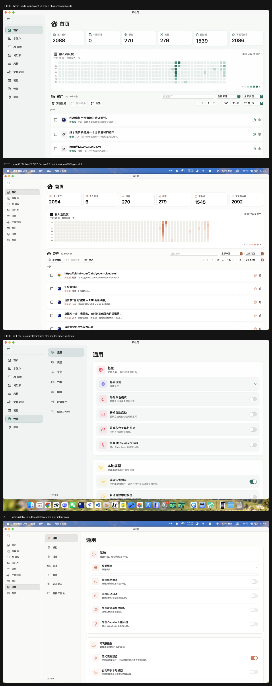
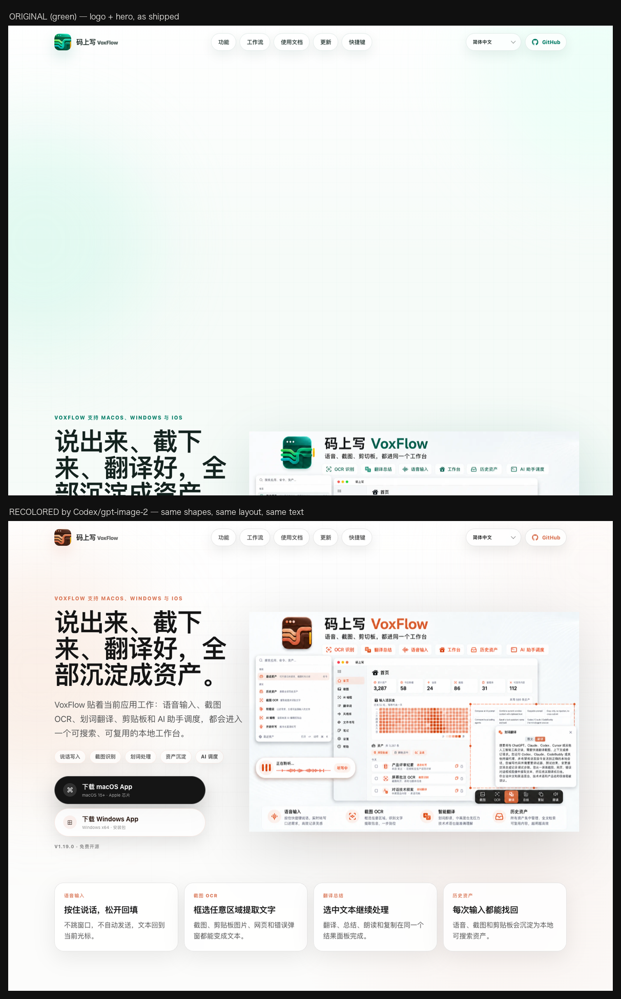
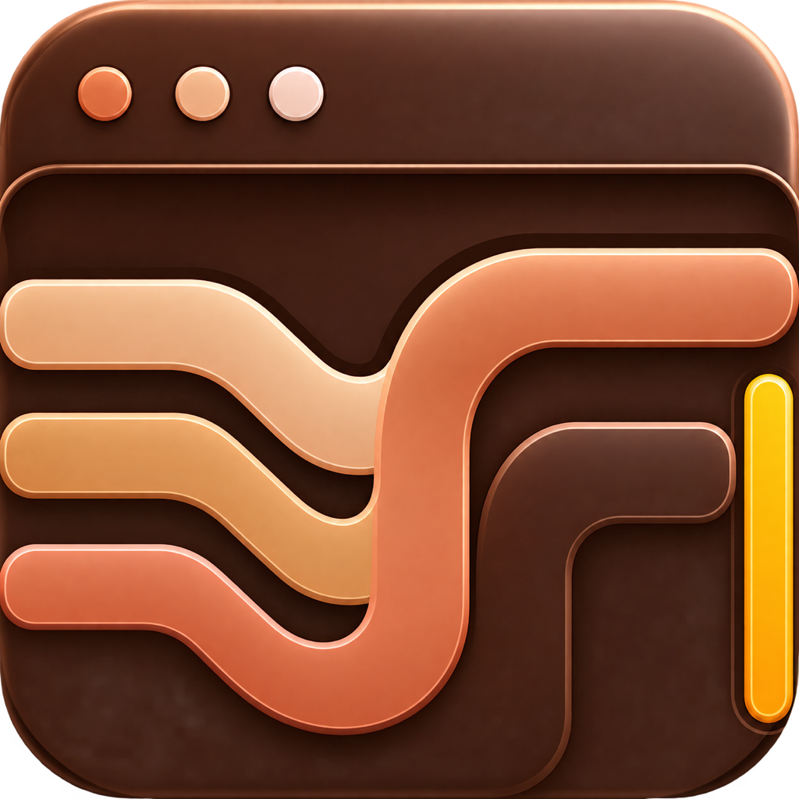

# CDS（Claude Design System）UI 迁移记录

参考规范：[open-claude-ui](https://github.com/Caho1/open-claude-ui) 的 `code-examples/cds-theme.css`、
`tailwind.config.js`、`ClaudeMotionPresets.ts`。

## 应用界面：改动前后

## 落地页：改动前后

## 令牌落点

| 层 | 文件 | 说明 |
|---|---|---|
| 令牌源 | `Sources/VoxFlowApp/DesignSystemBridges/CDSTokens.swift` | Clay / Surface 0-3 / Stroke / Fill / Text / Semantic / Radius / Spring / Easing / Typography |
| 应用门面 | `Sources/VoxFlowApp/DesignSystemBridges/AppTheme.swift` | 全部映射到 `CDS`，现有调用点自动继承 |
| 组件 | `CDSComponents.swift` | Ghost 按钮、分段胶囊、滚动渐隐遮罩、卡片/内嵌行表面、陶土呼吸点 |
| 开关 | `CDSToggleStyle.swift` | 替代系统蓝绿开关 |
| 截图工具 | `Sources/VoxFlowScreenshotKit/Design/ScreenshotPalette.swift` | 模块内无法依赖 App，独立镜像同一套陶土色 |
| 落地页 | `docs/styles.css` 的 `:root` | `--clay*` / `--shadow-*` / `--radius-*` / `--ease-*` 令牌，与原绿色值一一映射 |

## 关键取值

- 品牌色：浅色 `#D97757`（hover `#CC5A36`、strong `#C25124`），深色 `#E08264`
- 表面阶梯：`#F9F9F7` / `#FCFCFB` / `#FFFFFF` / `#FFFFFF`；深色 `#1B1B19` → `#32322D`
- 边框：`alpha(0.10)` 发丝线，单一闭合边框，取消卡片投影
- 圆角：面板 10 / 卡片 12 / 气泡 18 / 输入区 20 / 胶囊 999
- 动效：SPRING_BOUNCY(ζ=0.612)、SNAPPY(0.78)、GENTLE(0.55)、HEAVY_SNAP(1.0)
- 滚动渐隐：15%/30%/45%/60%/75%/87% 七档非线性 alpha（Canvas 绘制，不参与布局）
- 语义色：success/warning/danger 取代 `Color.green` / `Color.orange` / `systemRed` 散落用法

## Logo 与品牌资产

旧 Logo 是青绿渐变的斜杠窗口图形。新标**保留原有的全部构图**（squircle 底、
左上三圆点、三条波浪线条、右侧竖直琥珀长条、高光与内阴影），仅把绿色系
替换为陶土色系。底色仍是深色（深棕），不作明暗反转。

| 资产 | 文件 |
|---|---|
| App 图标 | `Resources/AppIcon.iconset/*` + `Resources/AppIcon.icns` |
| 落地页 Logo | `docs/assets/voiceinput-logo.png`、`docs/assets/optimized/voiceinput-logo*.webp` |
| 社交分享卡 | `docs/assets/wechat-share-logo.jpg` |
| Hero 宣传图 | `docs/assets/voxflow-hero-workbench-promo-{zh,en}.png` + `optimized/*.webp` |

图标从 1024px 母版导出 10 个尺寸，并经 alpha 阈值处理保证四角透明（`AppIconAssetTests` 校验）。

## 图片素材：由 Codex 用 gpt-image-2 重新生成（只改色系）

**核心约束：保留原图的明暗结构与构图，只换色相。**

所有图片都在 Codex 客户端对话里完成，以原图为参考图 + 目标色板，用 gpt-image-2 出图。
提示词的关键是显式要求「深色还是深色、亮色还是亮色」——早期一版因为没说清楚，
模型把深绿底改成了米白底，亮度相关性与原图只有 -0.01，等于重画，已废弃重做。

| 素材 | 生成方式 |
|---|---|
| App 图标 | 以原图标为参考：深棕底（#3A1C12→#2B140C）+ 陶土波形 + 琥珀长条 |
| Hero 宣传图 中/英 | 保留全部文案、组件位置、界面截图，仅换配色，并替换左上角新图标 |
| 社交分享卡 | 由新图标派生 |

### 保真度验证（与 git HEAD 原图逐像素对比）

| 素材 | 亮度相关性 | 平均亮度 | 绿色残留 |
|---|---|---|---|
| Logo | **0.925** | 89 → 76 | 0.001% |
| Hero 英文 | **0.950** | 234 → 235 | 0.000% |
| Hero 中文 | **0.965** | 233 → 235 | 0.000% |

亮度相关性接近 1 说明明暗结构未被破坏；早期失败版本仅 -0.01。

图标导出时对 alpha 做阈值清理，保证缩放到 16px 四角仍透明（`AppIconAssetTests` 校验）。

## 已覆盖范围

侧边栏、首页、媒体、AI 编程、词汇表、风格、文件转写、笔记、帮助、设置（通用/模型/语音/
划词助手/智能工作台）、录音 HUD、命令面板、分段控件（11 处原生替换为 CDS 胶囊）、
开关（5 处）、热力图、波形、截图选择层与标注工具、滚动截图/录屏 HUD、
落地页全站 CSS、App 图标、社交分享图、Hero 宣传图。

## 验证

- `swift test`：3503 tests, 0 failures
- `make debug`：`-warnings-as-errors` 构建通过
- 浅色 / 深色两套外观均在实机截图核对
- 落地页用 Playwright + Chrome 全页截图核对（中英文）
- 冷色残留扫描：`Sources/` 与 `docs/styles.css` 均为 0

## 已知说明

- macOS Dock 会缓存旧图标。若 Dock 仍显示绿色旧标，按 `AGENTS.md` 的 IconServices 深度清理流程处理。
- `TextResultPanelView` 的 tabs 由 `@ViewBuilder` 复合视图注入，仍使用系统分段控件
- `ScreenRecordingHUDPanel` 的录制红点刻意保留系统红（平台约定，且被既有测试锁定）